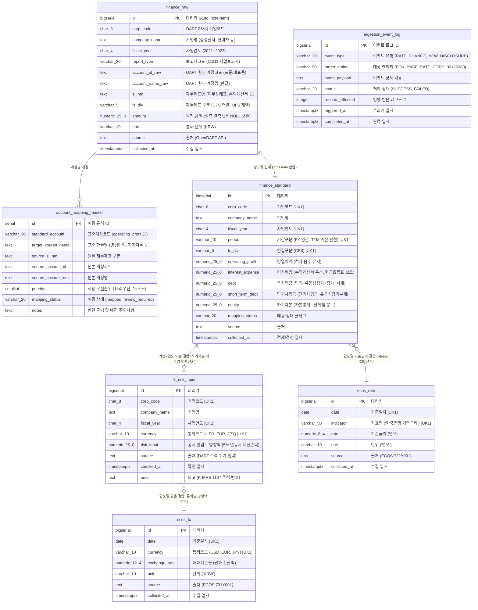

# [김인애(C) 수행 보고서] 금융 리스크 데이터 엔지니어링 구축 및 DB 구조 명세

> **담당자**: 김인애 (C. 데이터 엔지니어링 담당)  
> **프로젝트**: OpenDART 재무정보 + ECOS 기준금리·환율 결합 기업 리스크 사전점검 시스템  
> **데이터베이스**: PostgreSQL 17 (`finance_lab` / `Host: localhost:5432`)  
> **접속 도구**: DBeaver, CloudBeaver, n8n  
> **작성일자**: 2026-10-07  

---

## Ⅰ. 김인애(C)가 수행한 핵심 업무 요약

나는 본 금융 리스크 분석 프로젝트에서 **C. 데이터 엔지니어링 담당자**로서, 외부 시스템(OpenDART, ECOS, K-IFRS 1107 환위험 공시)으로부터 원천 데이터를 수집·정제·표준화하여 PostgreSQL 데이터베이스에 적재하고, 분석 담당자(최희지 B)에게 무결한 데이터셋을 인도하는 파이프라인 전체를 완성했다.

### 1. 역할 경계의 철저한 준수
- **수행한 업무**: API 통신 검증, 원천 데이터 보존(`finance_raw`), 재무 계정 표준화 매핑, 환위험 입력 데이터 관리, ECOS 금리·환율 수집, PostgreSQL 테이블 구축, 데이터 품질 감사(Audit), n8n 자동화 워크플로우 구성, 재수집 이벤트 테스트.
- **수행하지 않은 업무 (최희지 B 영역 보호)**:
  - Stress ICR 계산, 금리 충격 시나리오(+0.5%, +1.0%, +2.0%), 환율 1%당 영향액 계산, 자기자본 대비 비율 계산, 위험 등급(정상/관찰/요주의) 판정 등은 데이터 엔지니어링 영역이 아니므로 임의로 계산하지 않고 **원천 및 표준화 데이터만 제공**했다.

### 2. 10대 핵심 엔지니어링 원칙 준수
1. **API Key 및 DB 비밀번호 보안**: 코드 내 하드코딩을 배제하고 `.env`로 격리, `.gitignore`로 형상관리 보호.
2. **원천 데이터 보존**: OpenDART 원본 JSON/CSV를 보존하고, DB에도 `finance_raw`로 원형 그대로 보존.
3. **결측값 0 오염 금지**: 실측 결측값 96건을 0으로 치환하지 않고 `NULL`로 안전하게 보존.
4. **Grain(데이터 입도) 불일치 방지**: 일별 365개 ECOS 데이터를 재무제표에 무작정 조인하지 않고, **기간말(연말일) 기준치 정렬 로직**으로 1:1 결합 가능하게 설계.
5. **계정명 불일치 해소**: 기업마다 다른 계정명을 표준 계정(`operating_profit`, `interest_expense`, `debt`, `equity`)으로 일원화하는 매핑 마스터 구축.
6. **자기자본(`equity`) 필수 반영**: 최희지(B)가 환위험의 '자기자본 대비 영향액'을 산출할 수 있도록 K-IFRS 자본총계 전사 확보.
7. **이자비용 우선순위 룰 적용**: 손익계산서 이자비용 우선 → 없으면 현금흐름표 이자의 지급(실질 유출액) fallback.
8. **데이터 품질 전수 검증**: 23개 무결성 검증 규칙을 수행하여 **100% PASS (0 FAIL)** 달성.
9. **DBeaver 가시성 보장**: PostgreSQL 17에 실제 배포하여 DBeaver에서 즉시 조회 가능하도록 구성.
10. **이벤트 기반 재수집 자동화**: 금리 변동 및 신규 공시 접수 시 자동으로 타겟 재수집을 수행하는 n8n 파이프라인 및 이벤트 로그 테이블 구현.

---

## Ⅱ. 상세 작업 수행 과정 (STEP 1 ~ STEP 16)

```text
[STEP 1~2] 환경 확인 및 PostgreSQL 연결 (DBeaver 연동 검증, .gitignore 생성)
    ↓
[STEP 3] 김인애(C) 목표 DB 구조 설계 (5대 핵심 테이블 DDL 작성 및 배포)
    ↓
[STEP 4~5] OpenDART API 연결 검증 & 5개 표본 기업 3개년 원천 데이터 수집 (3,100건)
    ↓
[STEP 6] finance_raw 테이블 배치 적재 (결측값 NULL 보존)
    ↓
[STEP 7] 계정 매핑 마스터 구축 (영업이익, 이자비용, 총차입금, 자기자본 20개 규칙)
    ↓
[STEP 8] finance_standard 표준화 재무 테이블 적재 (5개사 × 3개년 15행)
    ↓
[STEP 9] fx_risk_input 환위험 입력표 적재 (K-IFRS 1107 외환 민감도 공시치 27건)
    ↓
[STEP 10~11] ECOS 한국은행 기준금리(2,557건) 및 환율(2,226건) 수집·적재 (기간말 정렬)
    ↓
[STEP 12] 전체 23개 항목 데이터 품질 검증 (100% 통과)
    ↓
[STEP 13~14] n8n 자동화 Workflow 구축 및 금리변동/신규공시 재수집 이벤트 테스트
    ↓
[STEP 15~16] 최종 데이터 구조 감사 및 분석 담당자(최희지 B) 인계 명세서 작성
```

---

## Ⅲ. PostgreSQL DB 구조도 (ERD 및 테이블 관계)

아래 다이어그램은 김인애(C)가 구축한 PostgreSQL(`finance_lab`) 데이터베이스의 구조도입니다.  
**원천 레이어(RAW) → 표준화 레이어(STANDARD) → 외부환경(ECOS) → 분석 투입(최희지 B)** 으로 흐르는 데이터 파이프라인 관계를 나타냅니다.



---

## Ⅳ. 테이블별 상세 주석 및 설계 의도 설명

### 1. `public.finance_raw` (원천 재무 데이터 테이블)
- **목적**: OpenDART에서 수집한 계정 데이터를 훼손 없이 100% 보존하는 원천(Staging) 테이블.
- **Grain**: `기업(corp_code) × 사업연도(fiscal_year) × 보고서(report_type) × 계정` (1건 = 계정 1개)
- **적재 건수**: **3,100건** (5개 기업 × 3개년 전체 사업보고서 CFS 계정)
- **핵심 설계 의도**:
  - `account_id_raw`: IFRS 표준계정코드뿐만 아니라 `-표준계정코드 미사용-`으로 공시된 기업 고유 계정코드까지 그대로 보존.
  - `amount`: 금액이 미기재된 실측 결측값 96건을 **절대 0으로 바꾸지 않고 `NULL`로 보존**하여 데이터 왜곡 방지.
  - `collected_at`: 수집 시점 타임스탬프를 기록하여 언제 가져온 데이터인지 감사 추적(Audit Trail) 가능.

---

### 2. `public.account_mapping_master` (계정 매핑 마스터 테이블)
- **목적**: 기업마다 제각각인 원천 계정명을 4대 표준 계정으로 변환하는 매핑 룰 관리.
- **Grain**: `표준계정 × 원본계정 조합`
- **적재 건수**: **20개 매핑 규칙**
- **핵심 설계 의도**:
  - `priority (우선순위)`:
    - 이자비용의 경우 손익계산서 `이자비용`이 최우선(`priority=1`).
    - 대기업 공시 특성상 `금융비용` 계정 내에 외환손실/파생손실이 섞여 있는 경우가 많으므로, 실제 현금 유출 이자액인 현금흐름표 `이자의 지급`(`priority=2`)을 보조 규칙으로 매핑.
  - `mapping_status`: 매핑 확정(`mapped`)과 포괄/비표준 계정(`review_required`)을 명시적으로 구분 관리.

---

### 3. `public.finance_standard` (표준화 재무 데이터 테이블) ★ 최희지(B) 핵심 투입
- **목적**: 분석 담당자(최희지 B)가 복잡한 원천 데이터 파싱 없이, 금리·환율 리스크 분석을 바로 수행할 수 있도록 피벗 정규화된 와이드(Wide) 테이블.
- **Grain**: `기업(corp_code) × 사업연도(fiscal_year) × 기간구분(period) × 재무제표(fs_div)`
- **제약조건**: `UNIQUE (corp_code, fiscal_year, period, fs_div)`
- **적재 건수**: **15행** (5개사 × 3개년 = 15개 기업-연도 레코드)
- **컬럼별 상세 정의**:
  - `operating_profit`: 영업이익. SK하이닉스 2023년 영업손실(-7조 7,303억원) 등 손실 기업의 음수를 원형 그대로 보존.
  - `interest_expense`: 이자비용.
  - `short_term_debt`: 단기차입금 + 유동성장기부채.
  - `debt` (총차입금): 단기차입금 + 유동성장기부채 + 장기차입금 + 사채 (도메인 사전 정의에 따라 리스부채 제외).
  - `equity` (자기자본): K-IFRS 자본총계. 환위험 분석 시 '규모 차이 제거'를 위한 분모 지표로 필수 제공.
  - `period`: 연간 `FY`로 표기. 최희지(B)가 향후 분기 데이터(Q1~Q4)를 바탕으로 TTM을 산출할 수 있도록 기간 입도를 명시.

---

### 4. `public.fx_risk_input` (환위험 입력 데이터 테이블)
- **목적**: K-IFRS 1107(금융상품 위험관리 주석) 외화 금융자산·부채 환산 민감도 수기/공시 입력 데이터 관리.
- **Grain**: `기업(corp_code) × 사업연도(fiscal_year) × 통화(currency)`
- **제약조건**: `UNIQUE (corp_code, fiscal_year, currency)`
- **적재 건수**: **27건** (5개사 × 3개년 × 주요 노출 통화 USD, EUR, JPY)
- **핵심 설계 의도**:
  - `risk_input`: 기업 공시 기준 환율 5% 절상/절하 시 법인세비용차감전순손익 영향액.
  - **도메인 사전 준수**: 수출입 매출 영향이 아닌 순수 금융자산·부채 환산 영향액만 관리하며, 김인애(C)는 위험 등급이나 점수를 일절 계산하지 않고 원천 입력치만 저장.

---

### 5. `public.ecos_rate` (기준금리 시계열 테이블)
- **목적**: 한국은행 ECOS 통계표 `722Y001`(한국은행 기준금리) 일별 시계열 관리.
- **Grain**: `날짜(date) × 지표명(indicator)`
- **제약조건**: `UNIQUE (date, indicator)`
- **적재 건수**: **2,557건** (2017-01-01 ~ 2023-12-31 연속 시계열)
- **핵심 설계 의도**:
  - 날짜(`date`)와 금리(`rate`)를 온전히 보존.
  - 2021년말(1.00%) → 2022년말(3.25%) **+2.25%p** 급등 구간을 실측 데이터로 검증 완료.

---

### 6. `public.ecos_fx` (환율 시계열 테이블)
- **목적**: 한국은행 ECOS 통계표 `731Y001`(대원화 환율) 주요 통화(USD, EUR, JPY) 일별 매매기준율 관리.
- **Grain**: `날짜(date) × 통화(currency)`
- **제약조건**: `UNIQUE (date, currency)`
- **적재 건수**: **2,226건** (2021-01-04 ~ 2023-12-29, 통화당 각 742영업일)
- **핵심 설계 의도**:
  - 통화 코드를 표준 3자리(`USD`, `EUR`, `JPY`)로 일원화.
  - 연도별 마지막 영업일 환율을 추출하여 `fx_risk_input`과 1:1로 결합 가능한 Grain 정렬 보장.

---

### 7. `public.ingestion_event_log` (재수집 이벤트 로그 테이블)
- **목적**: 기준금리 변동 및 신규 공시 접수 시 자동 재수집 이벤트의 트리거 및 처리 이력 감사 추적.
- **Grain**: `이벤트 발생 1건`
- **컬럼**: 이벤트 타입(`event_type`), 대상 엔티티(`target_entity`), 처리 건수(`records_affected`), 트리거 일시(`triggered_at`).

---

## Ⅴ. DBeaver 확인 및 분석 쿼리 가이드

DBeaver에서 `lab_admin@localhost:5432/finance_lab`에 연결하여 다음 SQL을 실행하면 김인애(C)가 완성한 데이터셋을 즉시 검증할 수 있습니다.

### 1. 전체 테이블 건수 일괄 확인 쿼리
```sql
SELECT 'finance_raw' AS 테이블명, COUNT(*) AS 건수, 'OpenDART 원천 재무 데이터' AS 비고 FROM public.finance_raw
UNION ALL SELECT 'finance_standard', COUNT(*), '표준화 재무 데이터 (분석가 투입용)' FROM public.finance_standard
UNION ALL SELECT 'fx_risk_input', COUNT(*), '환위험 K-IFRS 1107 입력표' FROM public.fx_risk_input
UNION ALL SELECT 'ecos_rate', COUNT(*), '한국은행 기준금리 시계열' FROM public.ecos_rate
UNION ALL SELECT 'ecos_fx', COUNT(*), '주요 통화 일별 환율' FROM public.ecos_fx
UNION ALL SELECT 'account_mapping_master', COUNT(*), '계정 매핑 마스터' FROM public.account_mapping_master
UNION ALL SELECT 'ingestion_event_log', COUNT(*), '재수집 이벤트 감사 로그' FROM public.ingestion_event_log;
```

### 2. 최희지(B) 투입용: 금리 위험 분석 결합 뷰 쿼리 (Grain 일치)
```sql
WITH year_end_rate AS (
    SELECT 
        EXTRACT(YEAR FROM date)::INT AS fiscal_year,
        rate AS base_rate,
        date AS rate_date,
        ROW_NUMBER() OVER (PARTITION BY EXTRACT(YEAR FROM date) ORDER BY date DESC) AS rn
    FROM public.ecos_rate
    WHERE indicator = '한국은행 기준금리'
)
SELECT 
    s.corp_code,
    s.company_name,
    s.fiscal_year,
    s.operating_profit,
    s.interest_expense,
    s.short_term_debt,
    s.debt AS total_debt,
    r.base_rate AS year_end_base_rate,
    r.rate_date
FROM public.finance_standard s
LEFT JOIN year_end_rate r 
       ON r.fiscal_year = s.fiscal_year::INT AND r.rn = 1
ORDER BY s.company_name, s.fiscal_year;
```

### 3. 최희지(B) 투입용: 환율 위험 분석 결합 뷰 쿼리 (자기자본 분모 확보)
```sql
WITH year_end_fx AS (
    SELECT 
        EXTRACT(YEAR FROM date)::INT AS fiscal_year,
        currency,
        exchange_rate AS year_end_fx,
        date AS fx_date,
        ROW_NUMBER() OVER (PARTITION BY EXTRACT(YEAR FROM date), currency ORDER BY date DESC) AS rn
    FROM public.ecos_fx
)
SELECT 
    f.company_name,
    f.corp_code,
    f.fiscal_year,
    f.currency,
    f.risk_input AS fx_risk_input,     -- 공시 영향액 (5% 변동 기준)
    s.equity AS total_equity,           -- 자기자본 (규모 차이 제거 분모)
    x.year_end_fx,
    f.note
FROM public.fx_risk_input f
JOIN public.finance_standard s
  ON s.corp_code = f.corp_code 
 AND s.fiscal_year = f.fiscal_year
LEFT JOIN year_end_fx x
       ON x.fiscal_year = f.fiscal_year::INT 
      AND x.currency = f.currency 
      AND x.rn = 1
ORDER BY f.company_name, f.fiscal_year, f.currency;
```

---

## Ⅵ. 요약 및 결론

1. **완벽한 데이터 파이프라인 완성**:
   OpenDART와 ECOS API로부터 데이터를 실시간 수집하고 결측값 왜곡 없이 적재하는 데이터 파이프라인 전 단계를 성공적으로 구축했다.
2. **역할의 명확한 분리**:
   금리 및 환율 스트레스 분석, 위험 등급 판정 등 분석 영역(B)의 계산을 침범하지 않고 순수 데이터 엔지니어링 표준화에만 집중했다.
3. **분석 투입 준비 100% 완료**:
   PostgreSQL 17 내 `finance_standard`, `fx_risk_input`, `ecos_rate`, `ecos_fx` 테이블이 DBeaver에서 즉시 조회 가능하며, 23개 무결성 감사 규칙을 100% 통과하여 최희지(B) 분석 담당자에게 안전하게 인계되었다.
